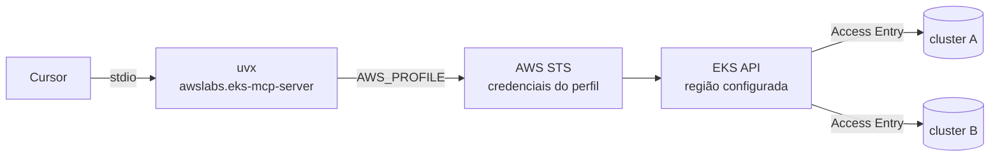

# Acesso AWS aos clusters EKS

Como a autenticação e a autorização funcionam no servidor MCP `eks`, e o que
precisa estar configurado na conta. O guia de uso está no
[README desta pasta](README.md).

Cada bloco de comando diz onde roda: **Windows** (PowerShell), **Linux** (bash)
ou **Windows e Linux**, quando é idêntico nos dois.

---

## Como funciona



São duas camadas independentes, e confundi-las é a origem da maioria dos erros:

| Camada | O que controla | Onde se configura | Erro típico |
|---|---|---|---|
| **Autenticação** (IAM) | quem você é para a AWS | perfil no AWS CLI | credenciais expiradas |
| **Autorização** (Kubernetes) | o que você pode fazer *dentro* do cluster | EKS Access Entry | `AccessDeniedException` |

Três consequências práticas:

- O servidor **não usa o seu kubeconfig**. Ele chama a API do EKS, gera o token
  na hora a partir das credenciais AWS e fala direto com o API server.
- Ter permissão IAM de `eks:DescribeCluster` faz o cluster **aparecer** na lista,
  mas não dá acesso aos recursos Kubernetes. Isso vem da access entry.
- Com perfil SSO, quando a sessão expira o MCP para de responder mesmo sem
  nenhuma mudança de configuração.

Nada disso muda entre Windows e Linux: o perfil, as permissões e as access
entries são os mesmos.

---

## Permissões IAM necessárias

No mínimo, para o modo somente leitura:

- `eks:DescribeCluster` e `eks:ListClusters`
- `eks:AccessKubernetesApi`

Para gerenciar access entries com os scripts de setup, acrescente:
`eks:CreateAccessEntry`, `eks:DescribeAccessEntry`, `eks:ListAccessEntries`,
`eks:AssociateAccessPolicy` e `eks:ListAssociatedAccessPolicies`.

Se for usar CloudWatch (`get_cloudwatch_logs`, `get_cloudwatch_metrics`), inclua
`logs:StartQuery`, `logs:GetQueryResults` e `cloudwatch:GetMetricData`.

---

## Descobrir o estado atual

**Windows**

```powershell
# quem sou eu
aws sts get-caller-identity --profile <PROFILE_NAME>

# clusters visíveis
aws eks list-clusters --profile <PROFILE_NAME> --region <REGION>

# modo de autenticação e endpoint do cluster
aws eks describe-cluster --name <CLUSTER_NAME> --profile <PROFILE_NAME> --region <REGION> `
  --query 'cluster.{auth:accessConfig.authenticationMode,publico:resourcesVpcConfig.endpointPublicAccess}'

# quem já tem access entry
aws eks list-access-entries --cluster-name <CLUSTER_NAME> --profile <PROFILE_NAME> --region <REGION>
```

**Linux**

```bash
# quem sou eu
aws sts get-caller-identity --profile <PROFILE_NAME>

# clusters visíveis
aws eks list-clusters --profile <PROFILE_NAME> --region <REGION>

# modo de autenticação e endpoint do cluster
aws eks describe-cluster --name <CLUSTER_NAME> --profile <PROFILE_NAME> --region <REGION> \
  --query 'cluster.{auth:accessConfig.authenticationMode,publico:resourcesVpcConfig.endpointPublicAccess}'

# quem já tem access entry
aws eks list-access-entries --cluster-name <CLUSTER_NAME> --profile <PROFILE_NAME> --region <REGION>
```

Dois pontos a observar no `describe-cluster`:

- **`authenticationMode`** precisa ser `API` ou `API_AND_CONFIG_MAP` para que
  access entries funcionem. Se estiver em `CONFIG_MAP`, o acesso ainda depende do
  `aws-auth` ConfigMap e é preciso migrar.
- **`endpointPublicAccess`** indica se dá para acessar de fora da VPC. Com
  endpoint privado, a estação precisa de VPN, Direct Connect ou bastion.

---

## Criar a access entry

**Windows**

```powershell
.\scripts\Setup-EksAccess.ps1 -Cluster <CLUSTER_NAME> -Profile <PROFILE_NAME> -Region <REGION>
```

**Linux**

```bash
./scripts/setup-eks-access.sh -c <CLUSTER_NAME> -p <PROFILE_NAME> -r <REGION>
```

Os dois scripts fazem o mesmo; só o nome das opções muda:

| Opção | Windows (`.ps1`) | Linux (`.sh`) |
|---|---|---|
| cluster (obrigatório) | `-Cluster` | `-c` |
| perfil | `-Profile` | `-p` |
| região | `-Region` | `-r` |
| ARN do principal | `-PrincipalArn` | `-n` |
| política | `-PolicyArn` | `-a` |

Sem o ARN do principal, o script usa o da sessão atual, convertendo o
`assumed-role` do STS no role IAM correspondente (inclusive no formato
`aws-reserved/sso.amazonaws.com/...` dos roles do Identity Center).

O script é idempotente: não falha se a entry ou a associação já existirem.

### Escolher a política

| Política | Permite |
|---|---|
| `AmazonEKSViewPolicy` | somente leitura — combina com o MCP sem `--allow-write` |
| `AmazonEKSEditPolicy` | leitura e alteração de workloads |
| `AmazonEKSAdminPolicy` | administração da maioria dos recursos |
| `AmazonEKSClusterAdminPolicy` | `cluster-admin` completo |

Para somente leitura:

**Windows**

```powershell
.\scripts\Setup-EksAccess.ps1 -Cluster <CLUSTER_NAME> `
    -PolicyArn arn:aws:eks::aws:cluster-access-policy/AmazonEKSViewPolicy
```

**Linux**

```bash
./scripts/setup-eks-access.sh -c <CLUSTER_NAME> \
    -a arn:aws:eks::aws:cluster-access-policy/AmazonEKSViewPolicy
```

Princípio prático: o modo somente leitura do servidor MCP é um *guardrail* de
conveniência; quem realmente limita o estrago é a política da access entry. Em
cluster de produção, prefira `AmazonEKSViewPolicy` a confiar só na ausência da
flag `--allow-write`.

O escopo padrão do script é `cluster` (todos os namespaces). Para restringir a
um namespace, associe a política direto pela CLI:

**Windows**

```powershell
aws eks associate-access-policy --cluster-name <CLUSTER_NAME> `
  --principal-arn <PRINCIPAL_ARN> `
  --policy-arn arn:aws:eks::aws:cluster-access-policy/AmazonEKSViewPolicy `
  --access-scope type=namespace,namespaces=<NAMESPACE>
```

**Linux**

```bash
aws eks associate-access-policy --cluster-name <CLUSTER_NAME> \
  --principal-arn <PRINCIPAL_ARN> \
  --policy-arn arn:aws:eks::aws:cluster-access-policy/AmazonEKSViewPolicy \
  --access-scope type=namespace,namespaces=<NAMESPACE>
```

---

## Referências

- [EKS access entries](https://docs.aws.amazon.com/eks/latest/userguide/access-entries.html) —
  conceito e migração a partir do `aws-auth` ConfigMap.
- [Associate access policies](https://docs.aws.amazon.com/eks/latest/userguide/access-policies.html) —
  comandos usados pelos scripts de setup.
- [Review access policy permissions](https://docs.aws.amazon.com/eks/latest/userguide/access-policy-permissions.html) —
  o que exatamente cada política concede.
- [IAM Identity Center com o AWS CLI](https://docs.aws.amazon.com/cli/latest/userguide/cli-configure-sso.html) —
  criar o perfil SSO e comportamento do `aws sso login`.
- [Pacote no PyPI](https://pypi.org/project/awslabs.eks-mcp-server/) — é o que o
  `uvx` resolve.

Uma divergência consciente em relação à documentação oficial: os botões de
instalação em um clique da AWS já vêm com `--allow-write`. Aqui a flag fica de
fora por padrão, o que a própria seção de segurança do README oficial sustenta
ao recomendar o modo somente leitura para produção.
